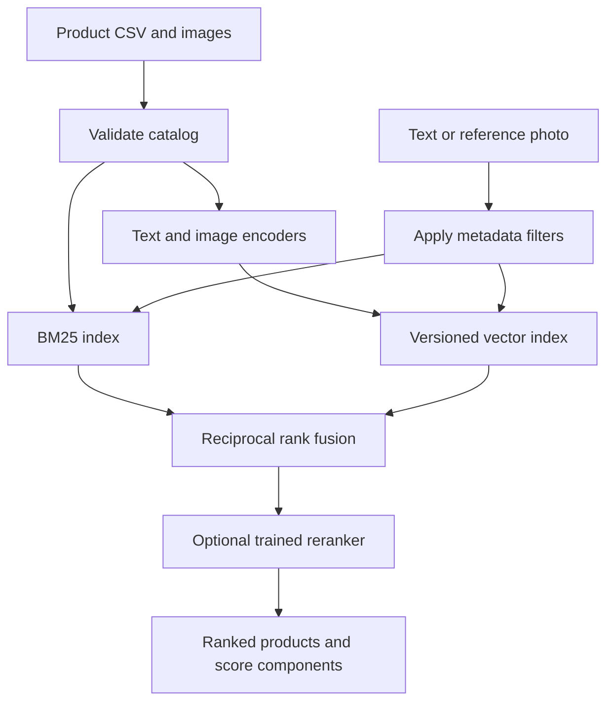

# SouqLens — Multimodal Product Search and Retrieval

English, Arabic and reference-image search for an e-commerce catalog. The project includes a keyword baseline, aligned pretrained image/text encoders, hybrid retrieval, supervised reranking, evaluation and a local API/demo.

The focus is on measurable retrieval behavior: which products are returned, how relevant they are, and how performance changes across languages and query types.

## Current checkpoints

| Checkpoint | Implemented |
| --- | --- |
| 1. Catalog + baseline | Validated CSV ingestion, variant-family IDs, English/Arabic normalization and BM25 |
| 2. Multimodal retrieval | Aligned CLIP encoders, text/image/combined queries, versioned indexes and RRF fusion |
| 3. Evaluation + learning | Group leakage checks, Recall/nDCG/MRR, query slices and pairwise linear reranking |
| 4. API + demo | FastAPI endpoints, browser search interface, filters, bounded image uploads and Docker baseline |
| 5. Real-model smoke verification | CPU model indexing, English/Arabic/image/combined retrieval, 120-pair reranker training and API inference |
| 6. Real catalog importer | Excel/CSV mapping, HTML cleanup, barcode cover matching and an import review report |
| 7. Hosting preparation | Checksummed real-data bundles, full-model Docker startup and source-only Space staging |
| 8. Free-hosting adapter | Gradio demo, ZeroGPU callback and source-only staging for eligible personal accounts |
| 9. GitHub-to-Space deployment | Secret-based source publishing to the existing Gradio/ZeroGPU Space, with SDK/hardware checks |

The pretrained encoders have been executed on CPU, including real image/text indexing, retrieval, reranker training and API inference on the sample fixtures. No real-catalog quality or business-impact result is claimed.

## Quick start — no model download

Use Python 3.10 or newer; Python 3.12 is the development target. The repository name ends with a period, so the clone URL contains two periods before `git`. An explicit local folder name also avoids a trailing period on Windows.

```bash
git clone https://github.com/HussamDroid/Multimodal-Product-Search-and-Retrieval..git souqlens
cd souqlens
python -m venv .venv
```

Activate the environment:

```powershell
# Windows PowerShell
.venv\Scripts\Activate.ps1
```

```bash
# macOS/Linux
source .venv/bin/activate
```

Install and run:

```bash
python -m pip install -e '.[api,dev]'
python -m unittest discover -s tests -v
souqlens baseline --catalog data/sample/catalog.csv --query "glass jar"
souqlens baseline --catalog data/sample/catalog.csv --query "برطمان زجاجي"
souqlens serve --catalog data/sample/catalog.csv --image-root data/sample
```

Open http://127.0.0.1:8000 for the search interface and http://127.0.0.1:8000/docs for API documentation. Without a vector index, the interface enables BM25 only; it does not simulate semantic or image search.

## Enable real multimodal retrieval

Install the ML extra. CPU inference is supported; a GPU is optional. Model weights are downloaded from Hugging Face on the first run and are not committed to Git.

```bash
python -m pip install -e '.[ml]'
souqlens index --catalog data/sample/catalog.csv --image-root data/sample --output artifacts/index-v1
souqlens search --index artifacts/index-v1 --query "برطمان زجاجي" --in-stock
souqlens search --index artifacts/index-v1 --image data/sample/images/jar-query.jpg
souqlens search --index artifacts/index-v1 --image data/sample/images/jar-query.jpg --query "small glass jar" --max-price 30
souqlens serve --index artifacts/index-v1 --image-root data/sample
```

`--device cuda` selects a compatible GPU. For a CPU-only PyTorch installation, follow the [official installation selector](https://pytorch.org/get-started/locally/) before installing the ML extra. Environments that use a SOCKS proxy may also require `python -m pip install socksio`.

### Models

| Purpose | Pretrained model |
| --- | --- |
| Multilingual text embeddings | [clip-ViT-B-32-multilingual-v1](https://huggingface.co/sentence-transformers/clip-ViT-B-32-multilingual-v1) |
| Image embeddings | [clip-ViT-B-32](https://huggingface.co/sentence-transformers/clip-ViT-B-32) |

These are an aligned text/image pair. The multilingual text encoder is distinct from the image encoder; arbitrary unrelated embeddings should not be averaged together. This project uses the published pretrained models and does not claim to have trained CLIP.

The index builder resolves model revisions to commit hashes. `--text-revision` and `--image-revision` can select explicit revisions. The manifest records model IDs, resolved revisions, Sentence Transformers version, catalog fingerprint, source-image checksums and vector-file checksum. Query encoders must match the index identity.

## Retrieval design



- Dense retrieval uses normalized embeddings and exact NumPy cosine search. It averages product-text and available cover-image similarities; products without images use text similarity only.
- Combined queries use a weighted image/text query vector. They express a preference, not a guaranteed structured constraint such as an exact physical size.
- Stock, category and price constraints are explicit filters applied before ranking.
- Hybrid retrieval uses reciprocal rank fusion rather than adding raw BM25 and cosine scores.
- The optional pairwise linear reranker learns weights for saturated BM25, cosine and product-name token coverage. It is a trained ranking model, not an embedding fine-tune.
- Search returns component scores. They are not calibrated probabilities.

The implementation favors an inspectable baseline over a distributed vector database. Approximate-neighbor indexing, a multilingual cross-encoder and embedding fine-tuning are follow-up experiments after collecting real relevance judgments.

## Evaluation

```bash
souqlens evaluate --catalog data/sample/catalog.csv --queries data/sample/queries.jsonl --image-root data/sample --mode bm25 --split test --output artifacts/bm25.json
souqlens evaluate --index artifacts/index-v1 --queries data/sample/queries.jsonl --image-root data/sample --mode dense --split test --output artifacts/dense.json
souqlens evaluate --index artifacts/index-v1 --queries data/sample/queries.jsonl --image-root data/sample --mode hybrid --split test --output artifacts/hybrid.json
souqlens train-ranker --index artifacts/index-v1 --queries data/sample/queries.jsonl --image-root data/sample --output artifacts/ranker-v1.json
souqlens evaluate --index artifacts/index-v1 --queries data/sample/queries.jsonl --image-root data/sample --mode hybrid --ranker artifacts/ranker-v1.json --split test --output artifacts/reranked.json
souqlens serve --index artifacts/index-v1 --image-root data/sample --ranker artifacts/ranker-v1.json
```

Output paths must be new. This keeps experiment artifacts from being overwritten by accident. Reports include per-query rankings, Recall@K, nDCG@K, MRR@K, English/Arabic/modality slices, first-query latency and warm p50/p95 latency. BM25 explicitly skips image and combined queries. Compare systems on matching query subsets.

Variant families cannot be relevant in multiple query splits. Training uses train judgments only and does not assume unjudged products are negative. The evaluator checks reranker training-family overlap with held-out queries. See [the evaluation protocol](docs/EVALUATION.md) for labeling guidance and limitations.

## Bring a real catalog

Use the [real catalog import guide](docs/REAL_CATALOG.md) to convert an existing Excel/CSV master and match your barcode folders. This includes Windows shared-drive commands and optional explicit column mappings.

The CSV schema is shown in [data/sample/catalog.csv](data/sample/catalog.csv). Required fields are `product_id`, `group_id`, `name_en`, `price` and `stock`. English/Arabic descriptions, Arabic names, category, barcode and image path are supported.

- Keep barcodes as text to preserve leading zeros.
- Put related variants under one `group_id` for evaluation splitting.
- Image paths are relative to the explicitly configured image root and cannot escape it.
- A barcode-folder export can use paths such as `00123456789/1.jpg`.
- Place private catalogs and photos under `data/private/`, which is ignored by Git.
- Only use data you have permission to process. Do not commit business exports or customer information.

The shipped sample has 12 fictional products, 18 example queries, synthetic images and illustrative relevance labels. Regenerate it with `python scripts/make_sample.py`. Synthetic images are not a substitute for independent customer photos in model evaluation.

## API

For a free portfolio deployment on an eligible Hugging Face personal account, follow [the Gradio / ZeroGPU guide](docs/ZEROGPU.md). Ordinary Docker/CPU Space creation has different account-plan requirements; verify that the free ZeroGPU option is available before creating a Space.

The target Space is `Hussam07/souqlens`. Follow [the GitHub-to-Space setup](docs/GITHUB_TO_SPACE.md) to add the deployment secret and run the prepared workflow. Source publishing is not enabled until the secret is configured.

For a Docker host, follow [the hosting guide](docs/HOSTING.md). Both routes use the same checksummed product bundle. Hosting still requires the real data and a selected account; no real-product deployment is live yet.

| Endpoint | Purpose |
| --- | --- |
| `GET /health` | Catalog size, configured modes, encoder identity and whether models are loaded |
| `POST /search/text` | JSON text query, retrieval mode, filters and optional reranking |
| `POST /search/image` | Multipart reference image, optional text and filters |
| `GET /products/{product_id}/image` | Read an image belonging to the configured catalog |
| `GET /docs` | Interactive API schema |

Image requests are limited to 10 MB / 20 megapixels. Uploaded query files are temporary and removed after the request. A configured index does not prove the query model has loaded; the first semantic request can be slower. The API defaults to localhost. Authentication, rate limiting, shared deployment, monitoring and load testing are not implemented.

Baseline Docker demo:

```bash
docker build -t souqlens .
docker run --rm -p 127.0.0.1:8000:8000 souqlens
```

## Verification

- Unit/integration tests cover CSV validation, normalization, filters, vector checksums, encoder mismatch, image/text query paths, relevance metrics, split leakage, ranker training and API validation.
- Tests use deterministic encoders for fast, download-free CI; this tests software behavior, not neural model accuracy.
- A BM25 evaluation smoke run on the synthetic test queries completed successfully. Its perfect fixture scores are intentionally not presented as real-catalog performance.
- Real pretrained CPU indexing, English/Arabic/image/combined retrieval, a 120-pair trained reranker and API inference completed on the synthetic fixtures. Detailed results and limits are in [docs/VERIFICATION.md](docs/VERIFICATION.md).
- Real-catalog evaluation, visual browser QA and a Docker build remain unverified.

## Repository layout

```text
src/souqlens/     catalog, encoders, indexes, retrieval, evaluation, reranker, API and UI
scripts/         reproducible fixture generator
data/sample/    fictional catalog, images and query judgments
tests/          software and API checks
docs/           evaluation protocol and verification notes
```

Large model weights, indexes, trained artifacts, private data and credentials are excluded from Git. Dependency ranges define supported installation inputs; use `pip freeze` and pinned model revisions to capture a specific experiment environment.
